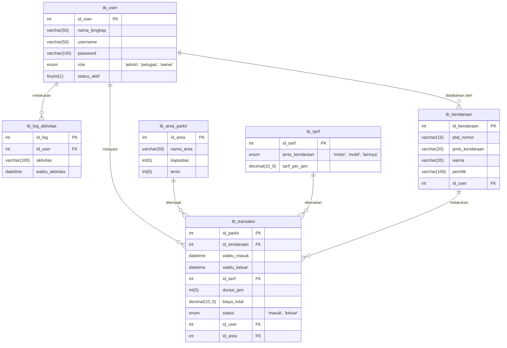

# Desain Database & ERD Aplikasi Parkir

Di bawah ini adalah struktur Entity Relationship Diagram (ERD) yang direpresentasikan menggunakan sintaks diagram Mermaid, sesuai dengan skema yang ada pada dokumen soal.

## 1. Diagram ERD

## 2. Rincian Kamus Data (Data Dictionary)

Berdasarkan skema pada soal, berikut rincian tabelnya:

1. **`tb_user`** (Menyimpan data pengguna)
   - `id_user`: Primary Key, INT(11)
   - `nama_lengkap`: VARCHAR(50)
   - `username`: VARCHAR(50)
   - `password`: VARCHAR(100)
   - `role`: ENUM ('admin', 'petugas', 'owner')
   - `status_aktif`: TINYINT(1)

2. **`tb_area_parkir`** (Menyimpan area/lokasi parkir beserta kapasitasnya)
   - `id_area`: Primary Key, INT(11)
   - `nama_area`: VARCHAR(50)
   - `kapasitas`: INT(5)
   - `terisi`: INT(5)

3. **`tb_tarif`** (Menyimpan master tarif per jam berdasarkan kendaraan)
   - `id_tarif`: Primary Key, INT(11)
   - `jenis_kendaraan`: ENUM ('motor', 'mobil', 'lainnya')
   - `tarif_per_jam`: DECIMAL(10,0)

4. **`tb_kendaraan`** (Menyimpan master data kendaraan, bisa jadi opsional jika plat langsung diinput di transaksi, namun sesuai relasi tabel ini eksis)
   - `id_kendaraan`: Primary Key, INT(11)
   - `plat_nomor`: VARCHAR(15)
   - `jenis_kendaraan`: VARCHAR(20)
   - `warna`: VARCHAR(20)
   - `pemilik`: VARCHAR(100)
   - `id_user`: Foreign Key, INT(11)

5. **`tb_transaksi`** (Tabel operasional untuk pencatatan parkir)
   - `id_parkir`: Primary Key, INT(11)
   - `id_kendaraan`: Foreign Key, INT(11)
   - `waktu_masuk`: DATETIME
   - `waktu_keluar`: DATETIME
   - `id_tarif`: Foreign Key, INT(11)
   - `durasi_jam`: INT(5)
   - `biaya_total`: DECIMAL(10,0)
   - `status`: ENUM ('masuk', 'keluar')
   - `id_user`: Foreign Key, INT(11) (Mencatat petugas siapa yang melayani)
   - `id_area`: Foreign Key, INT(11)

6. **`tb_log_aktivitas`** (Menyimpan log audit/aktivitas admin)
   - `id_log`: Primary Key, INT(11)
   - `id_user`: Foreign Key, INT(11)
   - `aktivitas`: VARCHAR(100)
   - `waktu_aktivitas`: DATETIME